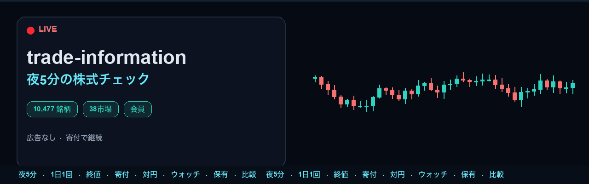
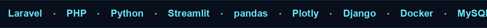
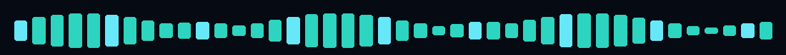
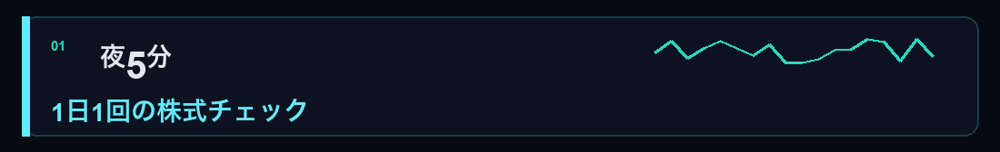
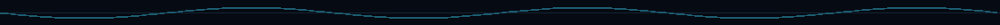

 

  

Kamimura Yuki です。  
知っている会社の株価を、仕事終わりの夜5分で見比べられるようにしています。公開しているサイトは Laravel、分析用の画面は Python で作っています。現在、iPhone / iPad 向け iOS版アプリの開発も進めています。

## 公開中のサイト

**[trade-information](https://trade-information.laravel.cloud/)** は、画面の題は「投資分析（夜5分の投資分析ラボ）」、ロゴの横は「夜5分」です。画面に張り付かない、夜5分の株式チェックです。デイトレのノイズを外し、終値・日足・比較・マクロ指標で読む、登録不要の株式チェックです。会社名やコードを入れると、終値・騰落・日足・配当・100株（米国株は1株）の必要資金まで登録なしで出ます。2026年に Laravel 13（PHP 8.5）で公開しました。売買の推奨ではありません。維持・運営には広告配信（Google AdSense）と任意の[投げ銭（開発支援）](https://trade-information.laravel.cloud/tip)を使っています。支援の有無で、公開の分析機能は変わりません。表示言語は日本語のほか、英語・中国語（簡体/繁体）・韓国語・スペイン語・フランス語・ドイツ語などに切り替えられます。

### 非会員機能（登録・ログイン不要）

ログインなしで開けます。終値のチャートと比較、計算、為替、マクロ指標、テクニカル分析まで公開しています。数字の出典と更新タイミングは[データの見方](https://trade-information.laravel.cloud/desk)にまとめています。

| 機能 | 仕様・できること |
| --- | --- |
| 世界マーケット相場 | 日米主要株価指数・先物・為替・暗号資産・コモディティ・債券利回りを網羅した相場ボード（日経平均、TOPIX、日経平均先物、東証グロース250、NYダウ、S&P500、NASDAQ100、SOX指数、ドル円、ユーロ円、ユーロドル、BTC/USD、WTI原油、金先物、米10年債利回り、日10年債利回り）。グリッド表示とヒートマップ表示の切替、リアルタイム連動、市場カテゴリ別フィルタ（日本市場、米国市場、為替・暗号資産、商品・金利）、各指数のミニスパークラインチャート、為替ペアから個別詳細への直接連携に対応 |
| 見出し | 外部RSSが取れたときだけ出す。取れないときは「いま表示できる見出しはありません」。売買の見通しや架空のニュースは出さない |
| マーケット・ファインダー | 業種別資金フロー・25日騰落レシオ（市場過熱度診断）・「セクター強弱ヒートマップ」、高配当・バリュー・成長等の「マルチファクター選別」、「決算・配当カレンダー」、[AI定量スコア診断](https://trade-information.laravel.cloud/simulator)への直接連携 |
| 銘柄一覧・検索 | [14,624銘柄](https://trade-information.laravel.cloud/Meigara)（日本株・米国株・日米ETF・世界主要市場）を企業名・日本語名・英語別名・証券コード（ティッカー）から検索（検索欄は `/` キー、ヘッダーは ⌘K）。38市場（アジア12・南北アメリカ6・欧州14・オセアニア2・中東3・アフリカ1）の国別フィルタ、テーマ別（高配当、メガバンク、商社、半導体、自動車、通信、米国テック、米国ETF）クイック絞り込み |
| 終値・騰落チェック & 今夜の終値 | その日の取引が終わったときの終値と前日比騰落を表示（取得不可時は「終値なし」）。一覧の値動き集計（上昇・下落・変わらず、平均騰落率、最大上昇・下落）。トップには代表銘柄の終値に加え、市場の向き・両端の終値・今夜詳細を開く件数・NISA成長投資枠で買える単元数など、終値だけで答える問いを並べる |
| 全銘柄の株価・配当・割安度プレビュー | トヨタ 7203、三菱UFJ 8306、NTT 9432、Apple AAPL、Microsoft MSFT をはじめ、登録されている全銘柄についてログイン不要で終値、日足チャート（終値推移・高値/安値）、配当利回り、PER、PBR、100株（米国株は1株）の必要資金・年間配当目安を確認可能。[1ページ要約](https://trade-information.laravel.cloud/try/7203)（`/try/銘柄コード`）もある |
| [分析ラボ](https://trade-information.laravel.cloud/lab) | 日足に特化した公開の分析画面。終値スクリーナーと、テクニカル・マクロ・比較への入口 |
| [銘柄比較](https://trade-information.laravel.cloud/compare) | 最大4銘柄を並べ、株価・騰落・配当・PER・PBRを登録なしで見比べられる。並びの保存だけ会員向け |
| [経済指標連動分析](https://trade-information.laravel.cloud/economic) | 金利・為替・景気指標と銘柄への影響を、登録なしで確認できるマクロ分析 |
| [テクニカル分析](https://trade-information.laravel.cloud/tools/technical-100) | 日足ベースの100手法スキャナー。秒足ではなく、終値の型を見る |
| [外国為替レート（FX）](https://trade-information.laravel.cloud/FX) | 主要通貨ペアの対円レートと日足チャート、テクニカル指標を登録なしで確認。全通貨一覧と為替テクニカルも公開。詳細の保存は会員向け |
| [資金計画](https://trade-information.laravel.cloud/plan) | 資金・リスク・エントリーから株数を試算。計算は登録不要、ウォッチへの水準保存だけ会員向け |
| [資産推移・FIRE・定量バックテスト総合ラボ](https://trade-information.laravel.cloud/simulator) | 登録不要。「積立・FIRE条件設定」（NISA非課税 vs 特定口座 vs 投資元本）、「5軸マルチファクターAI/定量銘柄スコアリング」、「売買ルール・積立戦略ヒストリカル検証ラボ」、「配当スノーボール（再投資複利）」 |
| [100種類の分析計算ツール](https://trade-information.laravel.cloud/tools) | 登録なしで計算できる。まず使うのは配当金、割安さの目安、買うのに必要な金額の3つ。見える数は見方で変わり、無料の初心者は8種、NISAは16種。中級・上級の案内では50種 / 100種 |
| [市場取引ルール・NISA解説](https://trade-information.laravel.cloud/Tradingrules) | 今夜の市場状況、日本株（前場・後場・大引け・単元株・T+2受渡）と米国株（冬時間/夏時間・現地T+1受渡）の取引時間、新NISA、FXの基本、日米の銘柄コード体系 |
| [ガイド](https://trade-information.laravel.cloud/guide)・[データの見方](https://trade-information.laravel.cloud/desk) | 夜5分の使い方、投資用語集、よくある質問、日足の見方。データの出典（J-Quants / Financial Modeling Prep）と終値が載るタイミング |
| 表示カスタマイズ・サイトマップ・SEO | 昼（ライト）と夜（ダーク）のテーマ切替。投資家モード（初心者・NISA・中級者・上級者）と[見方診断](https://trade-information.laravel.cloud/mode/hear)（3問）。PC向けデスク帯・モバイル向けボトムドックバー。[サイトマップ](https://trade-information.laravel.cloud/sitemap)、XML サイトマップ（`/sitemap.xml`）、パンくず、JSON-LD |
| [無料プランと有料プラン](https://trade-information.laravel.cloud/plans) | 無料は初心者・NISA（自動課金なし）。中級は月額 1,980円（年額 19,800円）、上級は月額 2,980円（年額 29,800円）として案内。特商法では、サブスクの開始時期は未定で、現在は定期課金・自動更新の決済は発生しないと記載 |
| 投げ銭（開発支援）・お知らせ・規約 | 任意の[投げ銭](https://trade-information.laravel.cloud/tip)（PayPal。クレジットカード / デビット / PayPal残高。100円〜100,000円、プリセット 500 / 1,000 / 3,000 / 5,000円。11月の維持ゴールとサポーターボード）。[お知らせ](https://trade-information.laravel.cloud/announcements)（iOSアプリ開発開始）、[運営者情報](https://trade-information.laravel.cloud/about)（運営名義はメイプルシステム開発）、[利用規約](https://trade-information.laravel.cloud/terms)、[プライバシーポリシー](https://trade-information.laravel.cloud/privacypolicy)、[免責事項](https://trade-information.laravel.cloud/disclaimer)、[特定商取引法に基づく表記](https://trade-information.laravel.cloud/tokushoho)、お問い合わせ |

### 会員機能（無料登録・要ログイン）

会員登録は無料です。パスワードは使わず、メールのログインリンク（マジックリンク）、パスキー（WebAuthn / FIDO2 生体認証）、または Google アカウントでログインできます。ウォッチ・保有・メモなど、保存して戻る機能です。比較の並び保存と為替詳細も会員向けです。PCI DSS v4.0 およびクレジットカード不正利用防止対策ガイドラインに準拠した多層防御（不審IP遮断・クレジットマスター防御、2FA本人確認、本人確認情報管理・使い捨てメール排除、連続失敗時のアカウント/IP自動ロック、新規端末ログイン通知メール、属性・行動リスクスコア分析、SHA-256デバイスフィンガープリント検知）を実装しています。

| 機能 | 仕様・できること |
| --- | --- |
| ウォッチリスト | 気になる銘柄を登録・管理。カスタムタグ付け、目標株価・損切りラインの記録、「今夜の確認（Tonight）」フラグ、CSVエクスポート、比較への連携 |
| ポートフォリオ（保有記録） | 保有銘柄の株数・取得単価・現在価格・タグを記録し、評価損益や取得金額割合を自動計算。CSVインポート／エクスポート |
| 投資メモ | 購入理由、目標価格・見直し価格、決算や取引の気付きを保存 |
| 比較の並び保存・資金計画の水準保存 | 公開の比較画面と資金計画の計算結果を、会員だけ手元に残せる |
| 為替詳細 | 公開の対円レート・日足に加え、詳細分析の保存は会員向け |
| マイページ・データ管理 | 今夜の確認状況、ウォッチ・保有・メモのサマリー（メイプルによる要約）、本人確認・パスキー・端末フィンガープリント、データの一括エクスポート。管理者には会員管理・支援金履歴・セキュリティ監視（ClamAV・不正IP遮断解除）・全体告知・銘柄一括管理 |

株価は1日に1回更新します。日本株は平日の夕方（取引終了後）に反映され、取引の途中の気配は含みません。この1日分を、日足と呼びます。日本株以外の株価と、通貨の交換レートも、その日の終わりの値段（終値）です。板情報や分足は出していません。このサイトは、1日の終わりの値段を見る場所です。投資助言や、売買の勧誘は行いません。

投げ銭（サイト運営支援）は任意の都度決済です。PayPal（残高、または VISA / Mastercard / JCB / American Express などのカード）で、100円から 100,000円まで指定できます。会員機能や投資助言の対価ではありません。使途は、毎晩の株価・FXデータ取得API、サーバー維持、機能開発です。公開を選ぶとサポーターボードへニックネームと応援メッセージが載ります。[特定商取引法に基づく表記](https://trade-information.laravel.cloud/tokushoho)を置いています。

## 分析用に作った画面

**[FX 為替マーケットダッシュボード](https://github.com/key-pro/streamlit)** は、Streamlit で作った手元用の分析画面です。`yfinance` から為替を取り、26通貨ペアをタイルで並べます。各タイルには価格、変動率、スパークラインがあり、そこから詳細へ進めます。米国株版は `main_us_stocks.py` から起動します。データには約15〜20分の遅れがあります。

| 分類 | 見られるもの |
| --- | --- |
| トレンド | SMA(20/50)、EMA(20)、ボリンジャーバンド、一目均衡表、DMI/ADX、パラボリックSAR、エンベロープ |
| オシレーター | RSI(14)、MACD、ストキャスティクス、サイコロジカルライン、RCI、移動平均乖離率、ヒストリカル・ボラティリティ |
| そのほか | ローソク足、フィボナッチ、ダブルボトム / ダブルトップや三尊の目視用表示、ダークとライトの切替 |

通貨ペアは、メジャー、クロス円、ユーロクロス、その他の4グループです。画面は `utils` でデータ取得と指標計算、`components` でチャートとゲージに分けています。

## 手元で使うツール

**[PDF統合ソフト](https://github.com/key-pro/PDF_Integration_App)**  
Tkinter の画面に PDF をドロップすると、ファイル名の数字順に並べて1つに結合します。PyInstaller で exe にできます。

**[Django + Docker](https://github.com/key-pro/Django_docker)**  
株価の取得と、scikit-learn による回帰を Django REST framework に載せた構成です。MySQL、Gunicorn、Docker Compose で動かします。

## 技術の使い分け

| 用途 | 技術 |
| --- | --- |
| 公開サイト | Laravel 13、PHP 8.5、MySQL、Alpine.js、Tailwind CSS。データ取得に J-Quants API / Financial Modeling Prep / Open Exchange Rates。パスワードレス認証（メールリンク、WebAuthn パスキー、Google OAuth）および PCI DSS v4.0 準拠の多層セキュリティ（デバイスフィンガープリント、属性・行動リスク分析、ClamAV連携）。PayPal による投げ銭決済、Google AdSense 広告配信 |
| モバイルアプリ（開発中） | Swift、SwiftUI、iOS / iPadOS（iPhone/iPad対応アプリを正式開発中） |
| 分析画面 | Python、Streamlit、pandas、Plotly、yfinance |
| API と実行環境 | Django REST framework、Docker、MySQL |
| 画面の基礎 | React、TypeScript、styled-components、Java |

## これまで

| 時期 | 内容 |
| --- | --- |
| 2022 | Django でブログ（[firstProject](https://github.com/key-pro/firstProject)）と、アカウント・カテゴリ付きの写真投稿（[photoProject](https://github.com/key-pro/photoProject)）。[React + TypeScript](https://github.com/key-pro/react-typescript-app) の画面演習。Java で[電卓](https://github.com/key-pro/java-calculator)、[デスクトップアプリ](https://github.com/key-pro/java_application)、[Web システム](https://github.com/key-pro/java_websystem)。[Video.js](https://github.com/key-pro/Video.js-Yes-improvement) の改善前後を並べた比較 |
| 2024 | Todo、メモ、電卓、ゲームを PHP / Python / JavaScript / C# で書き分け（[Training_data_2024](https://github.com/key-pro/Training_data_2024)）。株価アプリを Django と Docker に載せる |
| 2025 | PDF を結合するデスクトップアプリ。FX と米国株の Streamlit ダッシュボード |
| 2026 | [trade-information](https://trade-information.laravel.cloud/) を Laravel 13（PHP 8.5）でリリース。画面の題は投資分析（夜5分の投資分析ラボ）、ロゴの横は夜5分。終値・日足・比較・マクロ指標を登録なしで見る株式チェック。14,624銘柄、38市場、マーケット・ファインダー、分析ラボ、テクニカル100手法、経済指標連動分析、FX、資金計画、FIREラボ、計算ツールを公開。ウォッチ・保有・メモなど保存して戻る機能は無料会員。初心者・NISAは無料、中級・上級は有料プランとして案内（特商法上、定期課金の開始は未定）。iOSアプリ（iPhone/iPad対応）の開発を正式開始。Google AdSense と PayPal 投げ銭で運営 |

