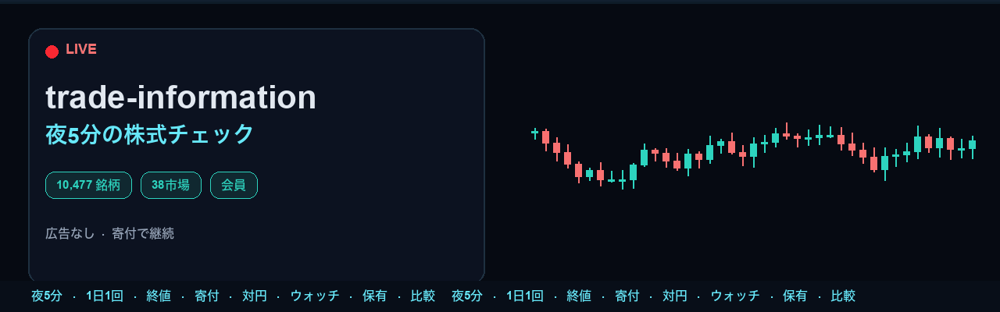
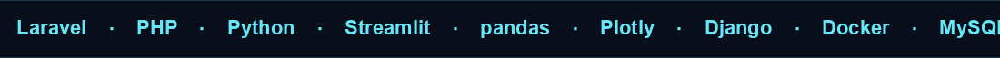
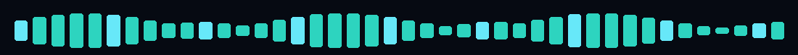
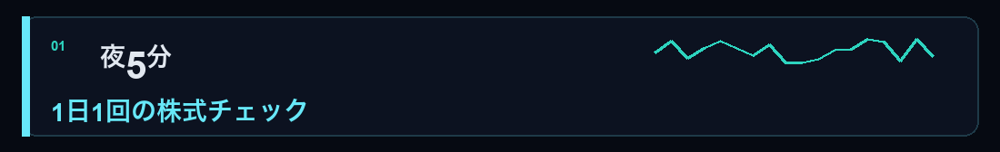
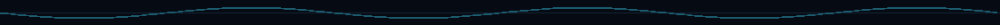

 

  

Kamimura Yuki です。
知っている会社の株価を、仕事終わりの夜5分で見比べられるようにしています。公開しているサイトは Laravel、分析用の画面は Python で作っています。

## 公開中のサイト

**[trade-information](https://trade-information.laravel.cloud/)** は、画面の題は投資分析、ロゴの横は夜5分です。表示は夜の紙面に切り替えられます。画面に張り付かない、夜5分の株式チェックです。デイトレのような秒単位の売買は不要で、仕事終わりに1日1回更新の株価を見ます。2026年に Laravel で公開しました。会員登録は無料です。売買の推奨ではありません。広告は載せず、[読む人の寄付](https://trade-information.laravel.cloud/donate)で続けています。寄付しなくても、使える機能は同じです。

ログインなしで見られます。銘柄一覧は、会員登録なしで開けます。

| | |
| --- | --- |
| 銘柄一覧 | 知っている会社の、その日の株価です。前日より上がったか下がったかも並びます。[10,477銘柄](https://trade-information.laravel.cloud/Meigara)で、企業名・日本語名・証券コードから探せます。検索欄は / キーでも開けます。絞り込みは38市場です。アジアは日本、中国、香港、台湾、韓国、インド、シンガポール、タイ、マレーシア、インドネシア、フィリピン、ベトナム。南北アメリカは米国、カナダ、ブラジル、メキシコ、チリ、アルゼンチン。欧州は英国、ドイツ、フランス、オランダ、ベルギー、スペイン、イタリア、スイス、スウェーデン、ノルウェー、デンマーク、フィンランド、アイルランド、ギリシャ。オセアニアはオーストラリア、ニュージーランド。アフリカは南アフリカ。中東はイスラエル、UAE、トルコ。テーマは高配当、メガバンク、商社、半導体、自動車、通信、米国テック、米国ETF |
| 終値 | その日の取引が終わったときの株価です。騰落は、前日より上がったか下がったかです。取れない銘柄は「終値なし」と出します |
| 日本株 | 平日の夕方（取引終了後）に、その日の株価が更新されます |
| 米国株 | 米国の銘柄は、ドル建ての、その日の終わりの株価です |

登録なしで、検索するか、トヨタ、三菱UFJ、NTT、Apple、Microsoft をタップすると、株価と配当が出ます。サイト紹介では、トヨタ自動車、ソニーグループ、Apple、Microsoft の終値が出ます。

NISA・成長投資枠で個別株を探す人向けです。インデックスの積立を続けたまま、高配当の株や、知っている大企業を見てみたいときに使います。毎日開く必要はありません。分析ツールは50種類あります。最初はこの4つです。

| | |
| --- | --- |
| 配当利回り | 株価に対して、1年の配当が何%かを出します |
| 割安度チェック | 株価が1株あたり利益の何倍か（PER）を見て、高いか安いかの目安にします |
| 1年と1か月の配当 | 持っている株から、1年と、1か月あたりの配当の目安を出します |
| 買うのに必要な金額 | その株を買うのに、いくらかかるかを出します |

会員になると使えます。会員登録は無料です。チャート、FX、取引ルール、ウォッチリスト、保有記録、銘柄比較は会員限定です。ログインのあと、見方を選べます。どれか分からないときは、3つの質問で画面が決まります。投資の経験を診断するものではなく、あとから変えられます。

| | |
| --- | --- |
| 投資初心者 | その日の株価と、1日ごとの値動きだけを先に見ます。指標の細かい名前は出していません。分析ツールは8種類です |
| NISA | 長く持つ前提で、配当と割安さを先に見ます。非課税で買えるかは証券会社のNISA枠で確認します。分析ツールは16種類です |
| 投資中級者 | 終値、日足、テクニカルを見比べる標準の画面です。テクニカルは移動平均とボリンジャーです。分析ツールは50種類です |
| 投資上級者 | オシレーター、ファンダメンタルズ、需給まで開けます。チャートは日足と週足です。分析ツールは50種類です |

はじめの3手は、知っている会社を1つ探す、ウォッチに入れる、今夜の終値を見る、です。今夜のチェックは印刷できます。案内のメイプルはAIを使っていて、売買の推奨ではありません。数字は目安です。

| | |
| --- | --- |
| 銘柄の詳細 | 一覧は誰でも見られます。1日ごとの値動きのグラフ（日足）は、会員登録すると開けます。上級では週足、オシレーター、ファンダメンタルズ、需給も開けます |
| 為替 | 円との交換レートです。1日の終わりのレートを見ます |
| 取引ルール | はじめての人とNISA向けに、取引時間、受渡、成長投資枠でできることをまとめています |
| ウォッチ | 見たい銘柄を保存して、比較へ進めます |
| 保有 | 取得金額の割合と損益を残せます |
| 投資メモ | スタンス、目標、損切りを書き残せます |
| 銘柄比較 | 中級では騰落とテクニカル、上級ではオシレーターと財務も並べます |
| 資金計画 | 許容損失から株数を計算します |
| 分析ツール | 割安さ、配当、リスク、為替を計算します。見える数は見方で変わり、全部で50種類あります |
| 入り方 | パスワードは使わず、メールのログインリンク、パスキー、Google |

株価は1日に1回更新します。日本株は平日の夕方（取引終了後）に反映され、取引の途中の気配は含みません。この1日分を、日足と呼びます。日本株以外の株価と、通貨の交換レートも、その日の終わりの値段（終値）です。板情報や分足はありません。夜に一度見れば足ります。投資助言や、売買の勧誘は行いません。

寄付は任意で、会員機能や投資助言の対価ではありません。毎月は 500円、1,000円、3,000円です。1回は決済画面で 100円から指定でき、最初の表示は 1,000円です。毎月は、次回の請求より前に止められます。使途は、相場データの取得と、このサイトの運営費です。受付期間の定めはありません。金額によって、見える機能は変わりません。[特定商取引法に基づく表記](https://trade-information.laravel.cloud/tokushoho)を置いています。

## 分析用に作った画面

**[FX 為替マーケットダッシュボード](https://github.com/key-pro/streamlit)** は、Streamlit で作った手元用の分析画面です。`yfinance` から為替を取り、26通貨ペアをタイルで並べます。各タイルには価格、変動率、スパークラインがあり、そこから詳細へ進めます。米国株版は `main_us_stocks.py` から起動します。データには約15〜20分の遅れがあります。

| 分類 | 見られるもの |
| --- | --- |
| トレンド | SMA(20/50)、EMA(20)、ボリンジャーバンド、一目均衡表、DMI/ADX、パラボリックSAR、エンベロープ |
| オシレーター | RSI(14)、MACD、ストキャスティクス、サイコロジカルライン、RCI、移動平均乖離率、ヒストリカル・ボラティリティ |
| そのほか | ローソク足、フィボナッチ、ダブルボトム / ダブルトップや三尊の目視用表示、ダークとライトの切替 |

通貨ペアは、メジャー、クロス円、ユーロクロス、その他の4グループです。画面は `utils` でデータ取得と指標計算、`components` でチャートとゲージに分けています。

## 手元で使うツール

**[PDF統合ソフト](https://github.com/key-pro/PDF_Integration_App)**  
Tkinter の画面に PDF をドロップすると、ファイル名の数字順に並べて1つに結合します。PyInstaller で exe にできます。

**[Django + Docker](https://github.com/key-pro/Django_docker)**  
株価の取得と、scikit-learn による回帰を Django REST framework に載せた構成です。MySQL、Gunicorn、Docker Compose で動かします。

## 技術の使い分け

| 用途 | 技術 |
| --- | --- |
| 公開サイト | Laravel、PHP。会員ログインはメールリンク、パスキー、Google |
| 分析画面 | Python、Streamlit、pandas、Plotly、yfinance |
| API と実行環境 | Django REST framework、Docker、MySQL |
| 画面の基礎 | React、TypeScript、styled-components、Java |

## これまで

| 時期 | 内容 |
| --- | --- |
| 2022 | Django でブログ（[firstProject](https://github.com/key-pro/firstProject)）と、アカウント・カテゴリ付きの写真投稿（[photoProject](https://github.com/key-pro/photoProject)）。[React + TypeScript](https://github.com/key-pro/react-typescript-app) の画面演習。Java で[電卓](https://github.com/key-pro/java-calculator)、[デスクトップアプリ](https://github.com/key-pro/java_application)、[Web システム](https://github.com/key-pro/java_websystem)。[Video.js](https://github.com/key-pro/Video.js-Yes-improvement) の改善前後を並べた比較 |
| 2024 | Todo、メモ、電卓、ゲームを PHP / Python / JavaScript / C# で書き分け（[Training_data_2024](https://github.com/key-pro/Training_data_2024)）。株価アプリを Django と Docker に載せる |
| 2025 | PDF を結合するデスクトップアプリ。FX と米国株の Streamlit ダッシュボード |
| 2026 | [trade-information](https://trade-information.laravel.cloud/) を Laravel でリリース。画面の題は投資分析、ロゴの横は夜5分。夜5分、1日1回の株式チェック。ログイン後は見方を選べる。日足のグラフは会員。広告は載せず、寄付で続けている |

